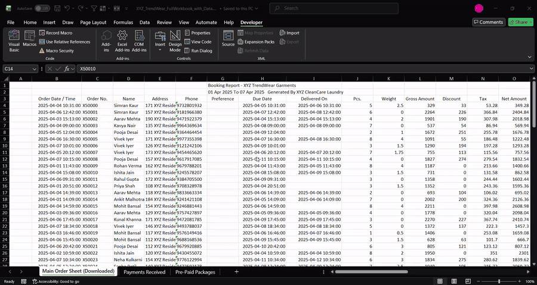
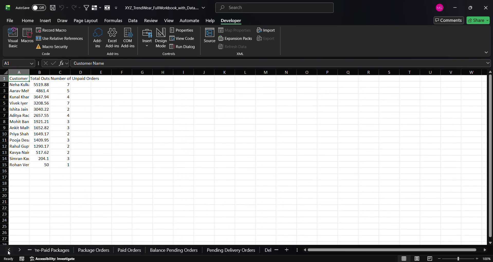
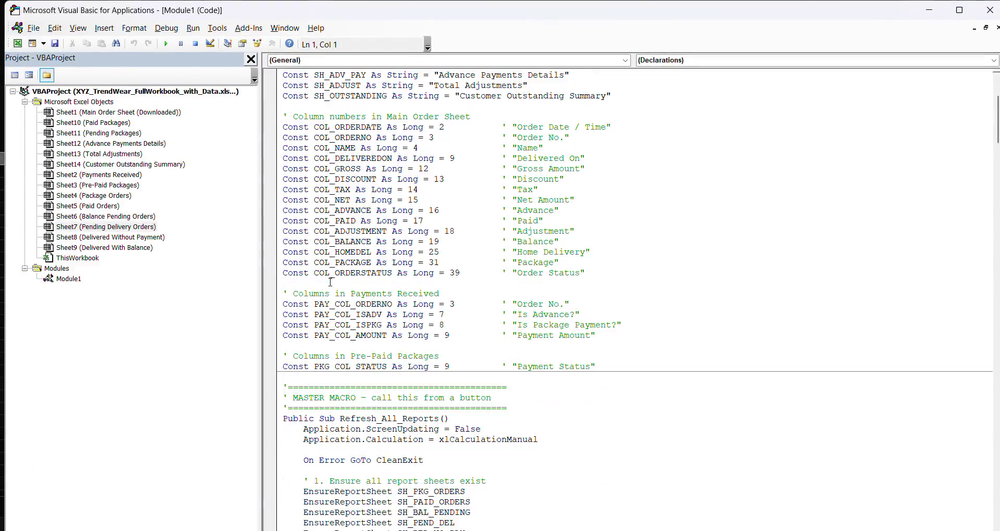

# TrendWear Order & Payment Reporting Automation (Excel VBA + Power BI)

One-click Excel VBA automation that turns a raw order export from a garment-care / laundry POS system into **11 ready-to-use operational and finance reports**, paired with a **3-page Power BI dashboard** covering sales, customer outstanding and pre-paid package performance.

Built for **XYZ TrendWear Garments** (fictional client, sample data).



▶️ Full demo video: [docs/demo/macro-demo.mp4](docs/demo/macro-demo.mp4)

## The problem

The store downloads a weekly booking report from its POS system. Finance and operations teams then had to filter it manually, again and again, to answer questions like:

- Which orders are delivered but still unpaid?
- Who owes us money, and how much?
- Which packages are paid and which are pending?
- What orders are still waiting for delivery?

## The solution

Paste the downloaded data into the input sheets and run one macro, **`Refresh_All_Reports`**. It rebuilds every report in seconds:

| # | Report sheet | Logic |
|---|---|---|
| 1 | Package Orders | Orders where `Package = "Yes"` |
| 2 | Paid Orders | `Balance <= 0`, not Cancelled |
| 3 | Balance Pending Orders | `Balance > 0`, not Cancelled |
| 4 | Pending Delivery Orders | `Delivered On` is blank, not Cancelled |
| 5 | Delivered Without Payment | Delivered and `Paid = 0` |
| 6 | Delivered With Balance | Delivered and `Balance > 0` |
| 7 | Paid Packages | Package `Payment Status = "Paid"` |
| 8 | Pending Packages | Package `Payment Status = "Pending"` |
| 9 | Advance Payments Details | Payments where `Is Advance? = "Yes"` |
| 10 | Total Adjustments | Orders with `Adjustment <> 0` |
| 11 | Customer Outstanding Summary | Balance grouped by customer (total + unpaid order count), sorted highest first |



## Key VBA techniques

- **Single master macro** orchestrating 11 report builders
- **Self-healing workbook**: missing report sheets are created automatically
- **Config constants** for all sheet names and column positions, so a change in the POS export layout means editing one line
- **`Scripting.Dictionary`** to aggregate outstanding balance per customer
- **Performance**: screen updating and auto-calculation switched off during the run, with a guaranteed restore through an error-handling exit
- **Defensive checks**: `IsNumeric` / `IsEmpty` guards against blank and text cells in raw exports



## Power BI dashboard (`powerbi/TrendWear_Dashboard.pbix`)

**Page 1 – Sales, Orders & Payments Overview**
KPI cards: Total Orders, Net Sales, Amount Paid, Outstanding, Pending Deliveries, Package Orders. Charts: orders by day, payment mix by type, balance by customer. Slicers: Order Status, Home Delivery, Area.

**Page 2 – Customer Outstanding & Payment Risk**
Outstanding by age bucket, customer-level ageing table, area map of outstanding, and a summary card.

**Page 3 – Package Sales, Usage & Revenue**
Package value, active packages and pending payments; revenue by package type; paid vs pending split; sales by day and by staff member; package expiry trend; payment delay.

## Workbook structure

**Input sheets**
| Sheet | Contents |
|---|---|
| Main Order Sheet (Downloaded) | POS booking export, 39 columns (headers on row 3, data from row 4) |
| Payments Received | Payment transactions: type, category, advance flag, amount, UTR |
| Pre-Paid Packages | Package sales, value, payment status, balance, expiry |

**Output sheets:** the 11 reports listed above, regenerated on every run.

## Repository layout

```
├── workbook/XYZ_TrendWear_Order_Payment_Reports.xlsm   # Excel app with macro
├── powerbi/TrendWear_Dashboard.pbix                    # Power BI dashboard
├── src/modules/Module1.bas                             # VBA source (text, diff-able)
├── data/sample/                                        # input sheets as CSV
├── docs/
│   ├── demo/        # demo video + GIF
│   └── screenshots/
└── scripts/export_vba.py                               # re-export VBA after edits
```

## How to run

1. Download `workbook/XYZ_TrendWear_Order_Payment_Reports.xlsm` and open it in Excel for Windows.
2. If a security banner appears: right-click the file → **Properties** → tick **Unblock**, reopen, and click **Enable Content**.
3. Paste a new POS export into **Main Order Sheet (Downloaded)**, keeping the same columns, with headers on row 3.
4. Go to **Developer → Macros → `Refresh_All_Reports` → Run**, or press `Alt + F8`.
5. Open `powerbi/TrendWear_Dashboard.pbix` in Power BI Desktop and click **Refresh**.

## Notes on the sample data

- The sample week has no cancelled orders, no delivered-but-fully-unpaid orders and no advance payments, so **Delivered Without Payment** and **Advance Payments Details** correctly return only headers.
- All customer names, phone numbers and addresses are fictional.

## Possible improvements

- Read column positions from header names instead of fixed numbers, so the macro survives export layout changes automatically
- Load rows into arrays rather than copying row by row, for faster runs on large exports
- Add a **Refresh Reports** button and a run-timestamp log
- Exclude cancelled orders from *Delivered Without Payment* as well

## Tech stack

Excel · VBA · Scripting.Dictionary · Power BI · DAX

## License

[MIT](LICENSE)
